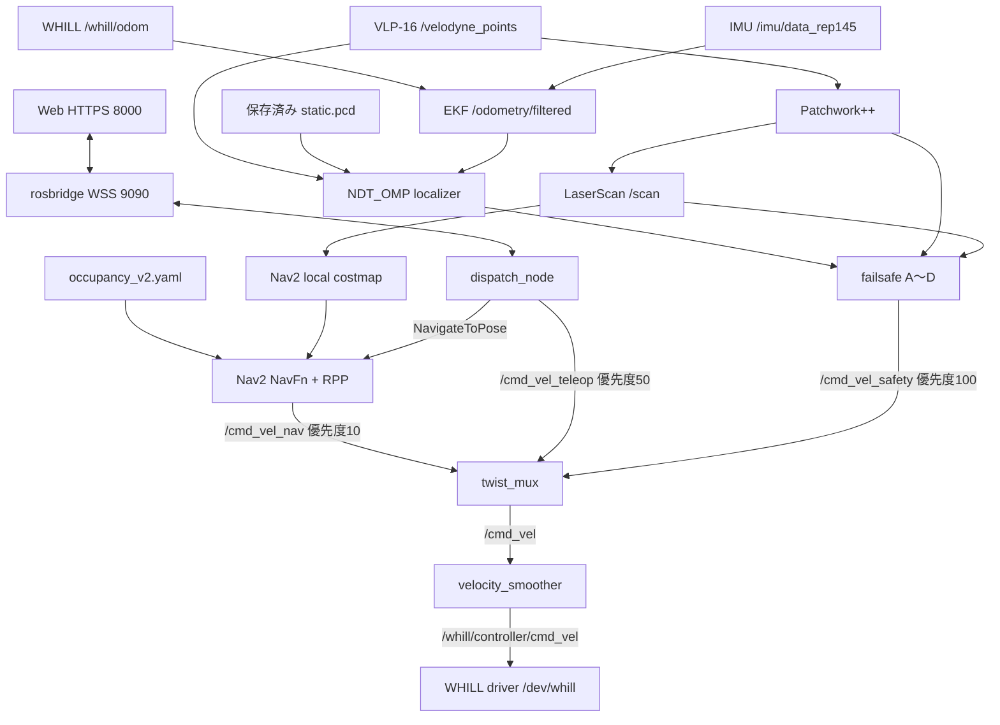

# 現在の実機構成

周波数は設定値または目安で、実測値ではない。

## 起動単位

| launch | 起動する構成 |
| --- | --- |
| `whill_safety/m6r_bringup_launch.py` | センサ、WHILL、EKF、localizer、failsafe、twist_mux |
| `whill_navigation/nav_launch.py` | Patchwork++、LaserScan変換、Nav2、velocity_smoother |
| `whill_dispatch/dispatch_launch.py` | dispatch、rosbridge/rosapi、Web配信。mock action は任意 |

bringup 内の sensors / odom / safety launch を別途重複起動しない。RealSense は `realsense:=true` のときだけ起動する。

## データの流れ

Web の背景画像は `src/whill_dispatch/web/map.png` と `map_meta.json`。Nav2 の地図を変更しても自動再生成されない。global costmap は static / inflation、local costmap は static / obstacle / inflation。

## TF とオドメトリ

| TF | 供給者 | 根拠 |
| --- | --- | --- |
| `map → odom` | `lidar_localization` | `m6r_lidar_localization.yaml` |
| `odom → base_link` | `robot_localization` EKF | `ekf_odom.yaml`、30 Hz |
| `base_link → imu_link / velodyne / camera_link` | 静的 TF | `static_tf_launch.py` |

EKF は `/whill/odom` の速度と `/imu/data_rep145` を融合する。生の `/imu/data_raw` は診断用に保持される。静的 TF の数値はセンサ README。

localizer は `NDT_OMP`、`use_odom: true`、`predict_pose_from_previous_delta: false`、`use_imu: false`。launch が odom 入力を `/odometry/filtered` に接続し、地図パスを一時 YAML に書き込む。初期位置は `/initialpose` から指定する。

## 速度と停止

twist_mux の全入力タイムアウトは 0.5 秒。failsafe の優先度100、手動50、Nav2 10。mux の出力は速度平滑化を通るため、停止指令の発行と車体の即時停止は同義ではない。

`speed:=slow|normal|fast` は RPP と smoother の前進速度上限を 0.30 / 0.45 / 0.60 m/s に設定する。既定は slow。runbook のデモ構成は normal を明示する。速度上限は実測速度・停止距離を保証しない。

RPP の `use_collision_detection` は true。カスタム BT は Spin / BackUp を含まないが、behavior_server のプラグイン設定には残っている。failsafe の監視範囲と制約は [安全層 README](../src/whill_safety/README.md) を参照。

## 地図作成と運用の分離

地図作成は bag → GLIM → DUFOMap → 占有格子 / v2 マスク合成。運用は `static.pcd` と `occupancy_v2.yaml`、配車地点を読む。GLIM を実機 localizer として起動しない。
